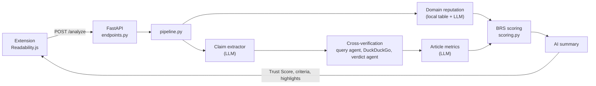

**English** | [Українська](README.uk.md)

<p align="center">
  
</p>

<p align="center">
  <a href="https://www.python.org/"></a>
  <a href="https://fastapi.tiangolo.com/"></a>
  <a href="https://docs.pydantic.dev/"></a>
  <a href="https://ai.google.dev/"></a>
  <a href="https://python.useinstructor.com/"></a>
  <a href="https://pypi.org/project/ddgs/"></a>
  <a href="https://developer.chrome.com/docs/extensions/mv3/intro/"></a>
  <a href="https://github.com/astral-sh/ruff"></a>
  <a href="LICENSE"></a>
</p>

# Veritas

A browser extension that estimates the credibility and objectivity of a news article while you read it. LLM agents extract claims, citations and manipulative phrases, the claims are cross-verified through DuckDuckGo, and a deterministic Beta Reputation System model (Jøsang & Ismail, 2002) turns that evidence into a transparent Trust Score.

**Features:** real-time analysis, cross-verification of up to 5 claims, domain reputation (about 55 known outlets plus an LLM lookup), Credibility / Transparency / Objectivity breakdown with visible formula inputs, in-page highlights, Ukrainian and English UI, and a "write and analyze" mode for pasted text.

## Engineering highlights

- **Hybrid design:** LLMs only extract evidence (claims, citations, manipulative phrases); every score is computed by a deterministic, unit-testable BRS model, so results are explainable and reproducible.
- **Async pipeline:** FastAPI + `asyncio.gather` run independent agents in parallel; claim verification fans out one task per claim.
- **Typed LLM I/O:** Gemini responses are parsed through `instructor` into Pydantic v2 models, so malformed output fails validation instead of leaking into scoring.
- **Resilience:** retries with backoff, primary/fallback model switching, search timeouts and graceful degradation to neutral scores when an agent or the search fails.
- **Cross-verification:** each claim goes through query generation, a DuckDuckGo search and an evidence-based verdict (confirmed, contradicted, unverified).
- **Evaluation harness:** benchmark scripts run curated article sets (including the ISOT Fake News dataset) through the API and produce charts and a test dashboard.
- **Full stack:** Manifest V3 extension (Readability.js, content script, service worker), Python backend and a React + Vite landing page.

## Architecture



The claim extractor and the domain lookup run in parallel. Everything the LLM returns is a count or a label; the scores themselves come only from the formulas in `scoring.py`.

## Project structure

```
backend/
├── app/
│   ├── main.py                       # FastAPI app, CORS, /health
│   ├── api/endpoints.py              # POST /analyze + in-memory cache
│   ├── models/schemas.py             # Pydantic request/response/agent schemas
│   ├── services/
│   │   ├── pipeline.py               # orchestrates the analysis
│   │   ├── cross_verification.py     # search queries, DuckDuckGo, claim verdicts
│   │   ├── domain_reputation.py      # local domain reputation table
│   │   ├── scoring.py                # BRS formulas and Trust Score
│   │   └── llm/
│   │       ├── base_agent.py         # Gemini client, retries, model fallback
│   │       ├── claim_extractor.py    # up to 5 verifiable claims
│   │       └── article_metrics_extractor.py  # citations, manipulative phrases
│   └── utils.py
├── tests/                            # benchmark scripts and test dashboard
└── requirements.txt

extension/                            # Manifest V3, Chromium browsers
├── manifest.json
├── background.js                     # service worker, talks to the backend
├── content.js + Readability.js       # article parsing and in-page highlights
├── popup.html / popup.js             # popup UI
├── parsed_text.html / parsed_text.js # full analytics page
├── styles.css
└── icons/

veritas-landing/                      # promo site (React + Vite)
docs/assets/banner.svg
```

## Quick start

Requirements: Python 3.11+, a Chromium-based browser, and a [Gemini API key](https://aistudio.google.com/apikey).

```bash
git clone https://github.com/MaksymKorchynskyi/veritas-extension-project.git
cd veritas-extension-project/backend
python -m venv venv && source venv/bin/activate   # Windows: venv\Scripts\activate
pip install -r requirements.txt
echo "GEMINI_API_KEY=your_key" > .env
uvicorn app.main:app --reload --host 127.0.0.1 --port 8000
```

Check `http://127.0.0.1:8000/health`, then load the extension: open `chrome://extensions/`, enable **Developer mode**, click **Load unpacked** and select the `extension/` folder.

Open a news article, click the Veritas icon and press analyze. The result takes 5 to 15 seconds. Without an API key the server still starts, but the AI agents are disabled and the analysis returns neutral results.

### API example

```bash
curl -X POST http://127.0.0.1:8000/analyze \
  -H "Content-Type: application/json" \
  -d '{"url": "https://example.com/news", "title": "Headline",
       "html_content": "<p>...</p>",
       "paragraphs": [{"id": 1, "text": "Article paragraph, at least 50 characters in total ..."}],
       "language": "en"}'
```

The response has `trust_score`, `criteria`, `explainer`, `highlights`, `scoring_inputs` and `extracted_claims`.

## Configuration

| Setting | Where | Default |
|---------|-------|---------|
| `GEMINI_API_KEY` | `backend/.env` | none (agents disabled) |
| Models | `MODEL_NAME`, `FALLBACK_MODEL_NAME` in `app/services/llm/base_agent.py` | `gemini-2.5-flash`, `gemini-3-flash-preview` |
| Cache TTL | `CACHE_TTL` in `app/api/endpoints.py` | 12 hours |
| Backend URL | `BASE_URL` in `extension/background.js` | `http://127.0.0.1:8000` |

## Scoring model

Each criterion is a Beta Reputation System expectation, `E(p) = (r + W * a) / (r + s + W)`, where `r` is positive evidence (confirmed claims, citations), `s` is negative evidence (contradicted or unverified claims, manipulative phrases), `W = 2` is the prior weight and `a` is the base rate (domain reputation for Credibility).

```
Trust Score = 0.5 * Credibility + 0.3 * Transparency + 0.2 * Objectivity
```

If Credibility is below 50, the result is multiplied by `0.5 + Credibility / 100`. See `backend/app/services/scoring.py`.

## Benchmarks

`backend/tests/` contains benchmark scripts, not unit tests. They send curated article sets to a running backend and write results to `backend/tests/results/` (not tracked by git). They call the Gemini API, so a key and quota are required. No benchmark numbers are published here; run the scripts to reproduce them.

```bash
cd backend && python tests/benchmark_articles.py && python tests/visualize_results.py
```

## Roadmap

- Offline unit tests for scoring and utilities.
- Pinned dependencies, linting configuration (`pyproject.toml`) and CI.
- A persistent, bounded response cache.
- Configurable CORS and timeouts for LLM calls.

## Contributing

Issues and pull requests are welcome. For larger changes, open an issue first. Keep changes focused, follow PEP 8, and never commit API keys or `.env` files.

## License

[MIT](LICENSE). Scoring model: Jøsang, A. and Ismail, R. (2002), "The Beta Reputation System", 15th Bled Electronic Commerce Conference.
