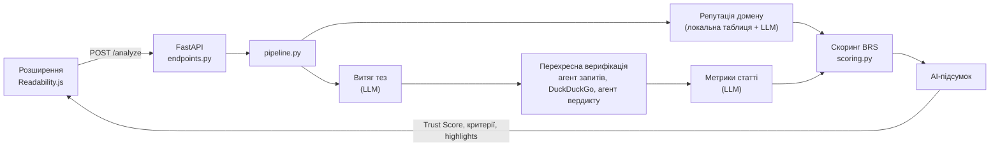

[English](README.md) | **Українська**

<p align="center">
  
</p>

<p align="center">
  <a href="https://www.python.org/"></a>
  <a href="https://fastapi.tiangolo.com/"></a>
  <a href="https://docs.pydantic.dev/"></a>
  <a href="https://ai.google.dev/"></a>
  <a href="https://python.useinstructor.com/"></a>
  <a href="https://pypi.org/project/ddgs/"></a>
  <a href="https://developer.chrome.com/docs/extensions/mv3/intro/"></a>
  <a href="https://github.com/astral-sh/ruff"></a>
  <a href="LICENSE"></a>
</p>

# Veritas

Розширення для браузера, яке оцінює достовірність та об'єктивність новинної статті під час читання. LLM-агенти витягують тези, цитування та маніпулятивні фрази, тези перевіряються перехресно через DuckDuckGo, а детермінована модель Beta Reputation System (Jøsang & Ismail, 2002) перетворює ці свідчення на прозорий Trust Score.

**Можливості:** аналіз у реальному часі, перехресна верифікація до 5 тез, репутація домену (близько 55 відомих медіа плюс пошук через LLM), розбивка на Достовірність / Прозорість / Об'єктивність з видимими вхідними даними формул, підсвічування на сторінці, інтерфейс українською та англійською, режим «Написати & Аналіз» для вставленого тексту.

## Технічні особливості

- **Гібридний дизайн:** LLM лише витягують свідчення (тези, цитування, маніпулятивні фрази); усі бали рахує детермінована модель BRS, яку можна тестувати, тож результат пояснюваний і відтворюваний.
- **Асинхронний конвеєр:** FastAPI + `asyncio.gather` паралельно запускають незалежні агенти; верифікація тез розгортається окремою задачею на кожну тезу.
- **Типізований вхід/вихід LLM:** відповіді Gemini парсяться через `instructor` у моделі Pydantic v2, тож некоректний вивід падає на валідації і не потрапляє у скоринг.
- **Стійкість:** повтори з відступом, перемикання основної та резервної моделі, таймаути пошуку та м'яка деградація до нейтральних балів, якщо агент чи пошук не спрацювали.
- **Перехресна верифікація:** кожна теза проходить генерацію запиту, пошук у DuckDuckGo і вердикт на основі доказів (підтверджено, спростовано, не перевірено).
- **Інструменти оцінювання:** бенчмарк-скрипти проганяють куровані набори статей (зокрема датасет ISOT Fake News) через API та формують графіки й тестовий дашборд.
- **Повний стек:** розширення Manifest V3 (Readability.js, content script, service worker), бекенд на Python і лендінг на React + Vite.

## Архітектура



Витяг тез і перевірка домену виконуються паралельно. LLM повертає лише числа та мітки; самі бали рахуються виключно за формулами в `scoring.py`.

## Структура проєкту

```
backend/
├── app/
│   ├── main.py                       # застосунок FastAPI, CORS, /health
│   ├── api/endpoints.py              # POST /analyze + кеш у пам'яті
│   ├── models/schemas.py             # Pydantic-схеми запитів/відповідей/агентів
│   ├── services/
│   │   ├── pipeline.py               # оркеструє аналіз
│   │   ├── cross_verification.py     # пошукові запити, DuckDuckGo, вердикти по тезах
│   │   ├── domain_reputation.py      # локальна таблиця репутації доменів
│   │   ├── scoring.py                # формули BRS і Trust Score
│   │   └── llm/
│   │       ├── base_agent.py         # клієнт Gemini, повтори, резервна модель
│   │       ├── claim_extractor.py    # до 5 верифікованих тез
│   │       └── article_metrics_extractor.py  # цитування, маніпулятивні фрази
│   └── utils.py
├── tests/                            # бенчмарк-скрипти та тестовий дашборд
└── requirements.txt

extension/                            # Manifest V3, Chromium-браузери
├── manifest.json
├── background.js                     # service worker, зв'язок із бекендом
├── content.js + Readability.js       # парсинг статті та підсвічування на сторінці
├── popup.html / popup.js             # інтерфейс попапа
├── parsed_text.html / parsed_text.js # повна сторінка аналітики
├── styles.css
└── icons/

veritas-landing/                      # промо-сайт (React + Vite)
docs/assets/banner.svg
```

## Швидкий старт

Вимоги: Python 3.11+, браузер на основі Chromium, [API-ключ Gemini](https://aistudio.google.com/apikey).

```bash
git clone https://github.com/MaksymKorchynskyi/veritas-extension-project.git
cd veritas-extension-project/backend
python -m venv venv && source venv/bin/activate   # Windows: venv\Scripts\activate
pip install -r requirements.txt
echo "GEMINI_API_KEY=ваш_ключ" > .env
uvicorn app.main:app --reload --host 127.0.0.1 --port 8000
```

Перевірте `http://127.0.0.1:8000/health`, потім завантажте розширення: відкрийте `chrome://extensions/`, увімкніть **Режим розробника**, натисніть **Завантажити розпаковане** і оберіть папку `extension/`.

Відкрийте новинну статтю, натисніть іконку Veritas і кнопку аналізу. Результат з'являється за 5–15 секунд. Без API-ключа сервер запускається, але AI-агенти вимкнені, а аналіз повертає нейтральні результати.

### Приклад API

```bash
curl -X POST http://127.0.0.1:8000/analyze \
  -H "Content-Type: application/json" \
  -d '{"url": "https://example.com/news", "title": "Заголовок",
       "html_content": "<p>...</p>",
       "paragraphs": [{"id": 1, "text": "Абзац статті, разом щонайменше 50 символів ..."}],
       "language": "uk"}'
```

Відповідь містить `trust_score`, `criteria`, `explainer`, `highlights`, `scoring_inputs` та `extracted_claims`.

## Конфігурація

| Параметр | Де | За замовчуванням |
|----------|----|------------------|
| `GEMINI_API_KEY` | `backend/.env` | немає (агенти вимкнені) |
| Моделі | `MODEL_NAME`, `FALLBACK_MODEL_NAME` у `app/services/llm/base_agent.py` | `gemini-2.5-flash`, `gemini-3-flash-preview` |
| TTL кешу | `CACHE_TTL` у `app/api/endpoints.py` | 12 годин |
| URL бекенду | `BASE_URL` у `extension/background.js` | `http://127.0.0.1:8000` |

## Модель скорингу

Кожен критерій — очікування Beta Reputation System, `E(p) = (r + W * a) / (r + s + W)`, де `r` — позитивні свідчення (підтверджені тези, цитування), `s` — негативні (спростовані чи неперевірені тези, маніпулятивні фрази), `W = 2` — вага апріорної інформації, `a` — базова ставка (репутація домену для Достовірності).

```
Trust Score = 0.5 * Достовірність + 0.3 * Прозорість + 0.2 * Об'єктивність
```

Якщо Достовірність нижча за 50, результат множиться на `0.5 + Достовірність / 100`. Див. `backend/app/services/scoring.py`.

## Бенчмарки

`backend/tests/` містить бенчмарк-скрипти, а не юніт-тести. Вони надсилають куровані набори статей на запущений бекенд і зберігають результати в `backend/tests/results/` (не відстежується git). Скрипти викликають Gemini API, тож потрібні ключ і квота. Числа бенчмарків тут не публікуються; щоб відтворити їх, запустіть скрипти.

```bash
cd backend && python tests/benchmark_articles.py && python tests/visualize_results.py
```

## Дорожня карта

- Офлайн юніт-тести для скорингу та утиліт.
- Зафіксовані залежності, конфігурація лінтера (`pyproject.toml`) і CI.
- Постійний кеш відповідей з обмеженим розміром.
- Налаштовуваний CORS і таймаути для викликів LLM.

## Внесок

Issues та pull requests вітаються. Для більших змін спершу відкрийте issue. Тримайте зміни сфокусованими, дотримуйтесь PEP 8 і ніколи не додавайте у репозиторій API-ключі чи файли `.env`.

## Ліцензія

[MIT](LICENSE). Модель скорингу: Jøsang, A. and Ismail, R. (2002), "The Beta Reputation System", 15th Bled Electronic Commerce Conference.
