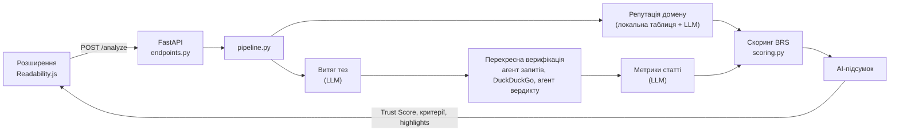

[English](README.md) | **Українська**

<p align="center">
  
</p>

<p align="center">
  <a href="https://www.python.org/"></a>
  <a href="https://fastapi.tiangolo.com/"></a>
  <a href="https://docs.pydantic.dev/"></a>
  <a href="https://ai.google.dev/"></a>
  <a href="https://python.useinstructor.com/"></a>
  <a href="https://pypi.org/project/ddgs/"></a>
  <a href="https://developer.chrome.com/docs/extensions/mv3/intro/"></a>
  <a href="https://github.com/astral-sh/ruff"></a>
  <a href="LICENSE"></a>
</p>

<p align="center">
  <a href="https://maksymkorchynskyi.github.io/veritas-extension-project/"></a>
  <br>
  <a href="https://maksymkorchynskyi.github.io/veritas-extension-project/">maksymkorchynskyi.github.io/veritas-extension-project</a>
  ·
  <a href="https://github.com/MaksymKorchynskyi/veritas-extension-project/actions/workflows/deploy-landing.yml"></a>
</p>

# Veritas

Розширення для браузера, яке оцінює достовірність та об'єктивність новинної статті під час читання. LLM-агенти витягують тези, цитування та маніпулятивні фрази, тези перевіряються перехресно через DuckDuckGo, а детермінована модель Beta Reputation System (Jøsang & Ismail, 2002) перетворює ці свідчення на прозорий Trust Score.

**Можливості:** аналіз у реальному часі, перехресна верифікація до 5 тез, репутація домену (54 відомих видань плюс пошук через LLM), розбивка на Достовірність / Прозорість / Об'єктивність з видимими вхідними даними формул, підсвічування на сторінці, інтерфейс українською та англійською, режим «Написати & Аналіз» для вставленого тексту.

## Технічні особливості

- **Гібридний дизайн:** LLM лише витягують свідчення (тези, цитування, маніпулятивні фрази); усі бали рахує детермінована модель BRS, яку можна тестувати, тож результат пояснюваний і відтворюваний.
- **Асинхронний конвеєр:** FastAPI + `asyncio.gather` паралельно запускають незалежні агенти; верифікація тез розгортається окремою задачею на кожну тезу.
- **Типізований вхід/вихід LLM:** відповіді Gemini парсяться через `instructor` у моделі Pydantic v2, тож некоректний вивід падає на валідації і не потрапляє у скоринг.
- **Стійкість:** повтори з відступом, перемикання основної та резервної моделі, таймаути пошуку та м'яка деградація до нейтральних балів, якщо агент чи пошук не спрацювали.
- **Перехресна верифікація:** кожна теза проходить генерацію запиту, пошук у DuckDuckGo і вердикт на основі доказів (підтверджено, спростовано, не перевірено).
- **Інструменти оцінювання:** бенчмарк-скрипти проганяють куровані набори статей (зокрема датасет ISOT Fake News) через API та формують графіки й тестовий дашборд.
- **Контроль якості:** офлайн юніт-тести із заглушками для всіх зовнішніх сервісів, `mypy --strict`, `ruff` (лінт і форматування) та обмежені діапазони версій залежностей.
- **Повний стек:** розширення Manifest V3 (Readability.js, content script, service worker), бекенд на Python і лендінг на React + Vite.

## Архітектура



Витяг тез і перевірка домену виконуються паралельно. LLM повертає лише числа та мітки; самі бали рахуються виключно за формулами в `scoring.py`.

## Як працює аналіз

1. **Парсинг.** Content script перетворює сторінку на пронумеровані абзаци за допомогою Readability.js. Service worker надсилає їх на `POST /analyze` разом із мовою інтерфейсу.
2. **Валідація і кеш.** Бекенд відхиляє порожній заголовок або менше ніж 50 символів тексту, потім перевіряє кеш у пам'яті (ключ: домен + заголовок + мова, TTL 12 годин).
3. **Паралельний збір свідчень.**
   - Агент витягу тез повертає до 5 перевірюваних тез (цифри, дати, конкретні події) з ID абзаців. Прогнози, думки та наміри виключені промптом.
   - Репутація домену береться з локальної таблиці з 54 видань. Для невідомих доменів бекенд шукає в DuckDuckGo оцінки фактчекерів і просить LLM їх оцінити; без свідчень значення лишається нейтральним 0.5.
4. **Перехресна верифікація кожної тези** (тези обробляються одночасно). Агент запитів формує пошуковий запит із 3–7 ключових слів, DuckDuckGo повертає 3 найкращі сніпети (таймаут 8 с), а агент перехресної перевірки відповідає CONFIRMED, CONTRADICTED або UNVERIFIED. Неоднозначні випадки за замовчуванням дають UNVERIFIED. Спростована теза стає highlight рівня `risk`; для підтверджених і спростованих тез зберігається URL доказу.
5. **Метрики статті.** Агент метрик отримує статтю та спростовані тези й повертає кількість цитувань, кількість маніпулятивних фраз (з точними фрагментами) та highlights абзаців. Прямі цитати, воєнна термінологія та нейтральна атрибуція («повідомляє», «за даними») не враховуються.
6. **Скоринг** за формулами BRS (див. нижче).
7. **Підсумок.** Агент підсумку пише 3–5 речень потрібною мовою за фінальними числами. Якщо агент метрик повністю не спрацював, API повертає нейтральний результат 50 / 50 / 50 замість помилки.

## Структура проєкту

```
backend/
├── app/
│   ├── main.py                       # застосунок FastAPI, CORS, /health
│   ├── api/endpoints.py              # POST /analyze
│   ├── models/schemas.py             # Pydantic-схеми запитів/відповідей/агентів
│   ├── services/
│   │   ├── cache.py                  # обмежений кеш відповідей (LRU + TTL)
│   │   ├── pipeline.py               # оркеструє аналіз
│   │   ├── cross_verification.py     # пошукові запити, DuckDuckGo, вердикти по тезах
│   │   ├── domain_reputation.py      # локальна таблиця репутації доменів
│   │   ├── scoring.py                # формули BRS і Trust Score
│   │   └── llm/
│   │       ├── base_agent.py         # клієнт Gemini, повтори, резервна модель
│   │       ├── claim_extractor.py    # до 5 верифікованих тез
│   │       └── article_metrics_extractor.py  # цитування, маніпулятивні фрази
│   └── utils.py
├── tests/                            # юніт-тести, бенчмарк-скрипти, тестовий дашборд
├── pyproject.toml                    # конфігурація ruff, mypy та pytest
├── requirements.txt
└── requirements-dev.txt

extension/                            # Manifest V3, Chromium-браузери
├── manifest.json
├── config.js                         # URL бекенду
├── background.js                     # service worker, зв'язок із бекендом
├── content.js + Readability.js       # парсинг статті та підсвічування на сторінці
├── popup.html / popup.js             # інтерфейс попапа
├── parsed_text.html / parsed_text.js # повна сторінка аналітики
├── styles.css
└── icons/

veritas-landing/                      # промо-сайт (React + Vite)
docs/assets/banner.svg
```

## Браузерне розширення

- `content.js` разом із `Readability.js` витягує статтю та малює підсвічування на сторінці.
- `background.js` за потреби вставляє content script, викликає бекенд, зберігає результати по вкладках у `chrome.storage.local` і тримає налаштування мови та підсвічування.
- `popup.html` / `popup.js` показують кільце Trust Score, три критерії, підсумок і кнопки повторного аналізу.
- `parsed_text.html` / `parsed_text.js` — сторінка аналітики: вхідні дані формул, витягнуті тези та посилання на докази.

## Швидкий старт

Вимоги: Python 3.11+, браузер на основі Chromium, [API-ключ Gemini](https://aistudio.google.com/apikey).

```bash
git clone https://github.com/MaksymKorchynskyi/veritas-extension-project.git
cd veritas-extension-project/backend
python -m venv venv && source venv/bin/activate   # Windows: venv\Scripts\activate
pip install -r requirements.txt
echo "GEMINI_API_KEY=ваш_ключ" > .env
uvicorn app.main:app --reload --host 127.0.0.1 --port 8000
```

Перевірте `http://127.0.0.1:8000/health`, потім завантажте розширення: відкрийте `chrome://extensions/`, увімкніть **Режим розробника**, натисніть **Завантажити розпаковане** і оберіть папку `extension/`.

Відкрийте новинну статтю, натисніть іконку Veritas і кнопку аналізу. Результат з'являється за 5–15 секунд. Без API-ключа сервер запускається, але AI-агенти вимкнені, а аналіз повертає нейтральні результати.

### API

`GET /health` повертає стан сервісу; інтерактивна документація доступна на `/docs`.

Запит `POST /analyze` (текст статті обмежений 200 000 символів):

| Поле | Тип | Примітки |
|------|-----|----------|
| `url` | string | з нього визначається домен |
| `title` | string | не може бути порожнім |
| `html_content` | string | очищений HTML статті |
| `paragraphs` | `[{id, text}]` | разом щонайменше 50 символів |
| `language` | `"uk"` або `"en"` | мова підсумку, за замовчуванням `uk` |

```bash
curl -X POST http://127.0.0.1:8000/analyze \
  -H "Content-Type: application/json" \
  -d '{"url": "https://example.com/news", "title": "Заголовок",
       "html_content": "<p>...</p>",
       "paragraphs": [{"id": 1, "text": "Абзац статті, разом щонайменше 50 символів ..."}],
       "language": "uk"}'
```

Відповідь:

| Поле | Опис |
|------|------|
| `trust_score` | від 0 до 100 |
| `criteria` | `credibility`, `transparency`, `objectivity` (по 0–100) |
| `explainer` | короткий AI-підсумок |
| `highlights` | `[{paragraph_id, severity: "warning" або "risk", category, reason}]` |
| `scoring_inputs` | лічильники та знайдені фрази, що пішли у формули |
| `extracted_claims` | `[{paragraph_id, claim_text, status, evidence_url}]` |

Некоректний вхід повертає HTTP 400.

## Конфігурація

| Параметр | Де | За замовчуванням |
|----------|----|------------------|
| `GEMINI_API_KEY` | `backend/.env` | немає (агенти вимкнені) |
| Моделі | `MODEL_NAME`, `FALLBACK_MODEL_NAME` у `app/services/llm/base_agent.py` | `gemini-2.5-flash`, `gemini-3-flash-preview` |
| Кеш | `DEFAULT_TTL_S`, `DEFAULT_MAX_ENTRIES` у `app/services/cache.py` | 12 годин, 512 записів |
| Дозволені джерела CORS | змінна середовища `VERITAS_CORS_ORIGIN_REGEX` | розширення браузера та `localhost` |
| URL бекенду | `extension/config.js` | `http://127.0.0.1:8000` |

## Модель скорингу

Кожен критерій — очікування Beta Reputation System, `E(p) = (r + W * a) / (r + s + W)`, з вагою апріорної інформації `W = 2`:

| Критерій | Позитивні свідчення `r` | Негативні свідчення `s` | Базова ставка `a` |
|----------|------------------------|-------------------------|-------------------|
| Достовірність | підтверджені тези + 0.2 x цитування | спростовані тези + 0.3 x маніпулятивні фрази + 0.4 x неперевірені тези | репутація домену |
| Прозорість | цитування | немає | 0.3 (стаття має це заслужити) |
| Об'єктивність | K - s | min(маніпулятивні фрази, K), де K = max(8, слова / 50) | 0.5 |

```
Trust Score = 0.5 * Достовірність + 0.3 * Прозорість + 0.2 * Об'єктивність
```

Якщо Достовірність нижча за 50, результат множиться на `0.5 + Достовірність / 100`. Реалізація: `backend/app/services/scoring.py`.

## Тестування

```bash
cd backend
pip install -r requirements-dev.txt
python -m pytest            # офлайн юніт-тести, API-ключ не потрібен
ruff check . && ruff format --check . && mypy
```

Набір покриває формули скорингу, склейку пайплайну, перехресну верифікацію, кеш, API (включно з CORS і валідацією) та логіку повторів обгортки LLM. Усі зовнішні сервіси замінені заглушками.

## Бенчмарки

У `backend/tests/` також є бенчмарк-скрипти. Вони надсилають куровані набори статей (ISOT Fake News і набір курсової роботи) на запущений бекенд і зберігають результати в `backend/tests/results/` (не відстежується git). Скрипти викликають Gemini API, тож потрібні ключ і квота. Числа бенчмарків тут не публікуються; щоб відтворити їх, запустіть скрипти.

```bash
cd backend
python -m tests.benchmark_articles      # ISOT, 50 статей
python -m tests.benchmark_coursework    # набір курсової, 48 статей
python -m tests.visualize_results       # графіки за останніми результатами
```

## Обмеження

- Вердикти спираються на три пошукові сніпети, а не на повні сторінки джерел. Це сигнал для подальшої перевірки, а не фактчекінг.
- Якість залежить від результатів DuckDuckGo і Gemini. Таймаут чи ліміт пошуку дає UNVERIFIED, що знижує Достовірність.
- Локальна таблиця охоплює 54 видання; для інших доменів використовується пошук разом з оцінкою LLM або нейтральне значення за замовчуванням.
- Текст статті та пошукові сніпети передаються LLM без змін, тож спеціально підготовлена стаття може намагатися керувати агентами (prompt injection). Бали евристичні й не є абсолютною істиною.
- Бекенд розрахований на локальний запуск. Кеш живе в пам'яті процесу й втрачається після перезапуску.
- Бали оцінюють ознаки достовірності; вони не визначають, що є правдою.

## Дорожня карта

- Безперервна інтеграція з запуском тестів, ruff і mypy.
- Розділення «не вдалося перевірити» (збій пошуку чи LLM) і «доказів не знайдено» у Достовірності.
- Захист вхідних даних LLM від prompt injection, перевірений на бенчмарк-наборах.
- Вужчі дозволи розширення (вставка content script на вимогу).

## Внесок

Issues та pull requests вітаються. Для більших змін спершу відкрийте issue. Тримайте зміни сфокусованими, перед pull request запускайте `ruff`, `mypy` і `pytest` та ніколи не додавайте у репозиторій API-ключі чи файли `.env`.

## Ліцензія

[MIT](LICENSE). Модель скорингу: Jøsang, A. and Ismail, R. (2002), "The Beta Reputation System", 15th Bled Electronic Commerce Conference.
